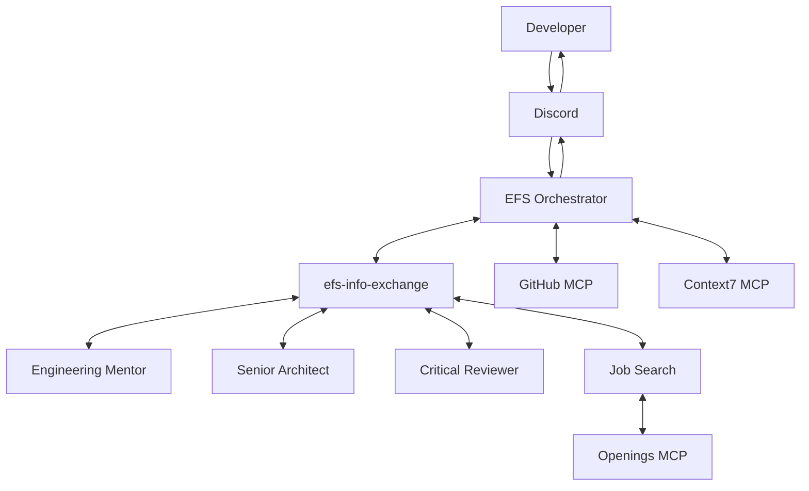

# EFS — Engineering Foundational Suite

**Beyond coding assistants. An entire AI engineering team.**

EFS (Engineering Foundational Suite) is a multi-agent AI platform designed to support developers throughout their engineering journey — from learning and building software to architecture reviews, critical feedback, and career discovery.

Built using **Switch and Codex-powered agents**, EFS brings together five specialized AI agents that collaborate through a central orchestrator. Developers can interact with the team through Discord instead of managing separate AI conversations.

---

## Table of Contents

- [The Problem](#the-problem)
- [Our Solution](#our-solution)
- [Meet the AI Engineering Team](#meet-the-ai-engineering-team)
- [Architecture](#architecture)
- [Technology Stack](#technology-stack)
- [Getting Started](#getting-started)
- [Configuring the Agents](#configuring-the-agents)
- [Setting Up MCP Integrations](#setting-up-mcp-integrations)
- [Connecting Discord](#connecting-discord)
- [Running EFS](#running-efs)
- [Testing the Workflow](#testing-the-workflow)
- [Troubleshooting](#troubleshooting)
- [Security](#security)
- [Project Structure](#project-structure)
- [Future Scope](#future-scope)
- [Contributing](#contributing)

---

## The Problem

Software engineering involves much more than writing code.

Developers regularly need to:

- Understand unfamiliar technologies and concepts.
- Make system architecture and design decisions.
- Review implementations and identify weaknesses.
- Get constructive feedback on technical approaches.
- Discover relevant job and career opportunities.

These activities often require different tools, workflows, and sources of information. A single general-purpose AI assistant may help with many of them, but coordinating specialized expertise remains a challenge.

We wanted to bring these capabilities together in one collaborative system.

## Our Solution

EFS is built around a simple idea:

**Instead of one AI assistant trying to do everything, let specialized AI agents work together as an engineering team.**

The platform consists of five specialized agents coordinated by the EFS Orchestrator.

A developer sends a request through Discord. The Orchestrator understands the request, identifies the relevant specialists, delegates tasks, gathers their responses through Switch, and presents a consolidated answer.

Not every request requires every agent. The Orchestrator involves specialists according to the task.

## Meet the AI Engineering Team

| Agent | Responsibility |
|---|---|
| EFS Orchestrator | Understands requests, delegates work, coordinates agents, and synthesizes responses. |
| Engineering Mentor | Explains technical concepts and guides developers through implementation challenges. |
| Senior Architect | Helps with system design, architecture decisions, and technical trade-offs. |
| Critical Reviewer | Independently challenges assumptions and identifies potential weaknesses. |
| Job Search | Discovers relevant career opportunities using Openings MCP. |

### 1. EFS Orchestrator

The central coordinator and developer's primary point of contact.

It classifies incoming requests, determines which specialists are relevant, delegates work, gathers their findings, and delivers a consolidated response.

### 2. Engineering Mentor

Provides technical mentorship, explains unfamiliar concepts, and helps developers understand implementation decisions.

### 3. Senior Architect

Assists with architectural planning, system design, technology choices, and engineering trade-offs.

### 4. Critical Reviewer

Provides independent technical feedback, questions assumptions, and identifies potential problems in proposed solutions.

### 5. Job Search

Helps developers discover relevant job opportunities through the Openings MCP integration.

---

## Architecture

EFS uses Switch as its core multi-agent collaboration and messaging infrastructure.



### How the workflow operates

1. A developer sends a request through Discord.
2. The EFS Orchestrator interprets the request.
3. The Orchestrator identifies which specialist agents are needed.
4. It delegates relevant tasks to those agents.
5. Agents communicate through the shared Switch room `efs-info-exchange`.
6. The Orchestrator gathers the actual responses.
7. A consolidated response is delivered to the developer.

The Orchestrator remains the primary point of contact throughout the interaction.

---

## Technology Stack

| Technology | Purpose |
|---|---|
| Switch | Multi-agent orchestration and collaboration infrastructure. |
| Codex | Agent runtime powering our implementation. |
| Discord | Developer-facing communication interface. |
| Model Context Protocol (MCP) | Connects agents to external tools and information. |
| GitHub MCP | GitHub-related engineering workflows. |
| Context7 MCP | Technical documentation access. |
| Openings MCP | Job discovery capabilities. |

### Important resources

- [Switch GitHub Repository](https://github.com/sandbox-quantum/switch)
- [Switch Documentation](https://docs.switchagents.ai/)
- [Codex Documentation](https://developers.openai.com/codex/)
- [Codex MCP Documentation](https://developers.openai.com/codex/mcp/)
- [GitHub MCP Server](https://github.com/github/github-mcp-server)
- [Context7 Documentation](https://context7.com/docs/installation)
- [Openings MCP](https://github.com/amikai/openings-mcp)

---

# Getting Started

This section describes how to reproduce the EFS reference setup.

**Important:** EFS is a Switch-based multi-agent configuration, not a standalone application that becomes operational simply by running a Python script. Cloning this repository gives you its project documentation and any configuration or source files included in the checkout. Switch, Codex, agent configuration, MCP connectivity, and Discord integration must also be set up.

## Prerequisites

Before beginning, make sure you have:

- Git installed.
- A GitHub account.
- Switch installed and accessible.
- Codex configured as the agent provider.
- Access to a Discord server where you can add a bot.
- Network connectivity for the required MCP integrations.
- Python 3 installed only if you are working with Python-based components included in the repository.

### Step 1: Clone the repository

```bash
git clone <YOUR_EFS_REPOSITORY_URL>
```

Move into the project directory:

```bash
cd EFS
```

Replace the repository URL and directory name with the actual values for your GitHub repository.

### Step 2: Prepare the local development environment

If the repository contains Python components with a `requirements.txt` file, create a virtual environment:

**Linux/macOS:**

```bash
python3 -m venv .venv
source .venv/bin/activate
```

**Windows PowerShell:**

```powershell
python -m venv .venv
.venv\Scripts\Activate.ps1
```

Install dependencies:

```bash
pip install -r requirements.txt
```

If the repository uses another dependency manager or does not contain Python dependencies, follow the relevant project manifest instead. Do not install unrelated dependencies simply to configure Switch.

### Step 3: Install and prepare Switch

Install Switch by following its official installation documentation:

[Switch Documentation](https://docs.switchagents.ai/)

Once installed:

1. Start or open your Switch environment.
2. Verify that the local Switch server is accessible.
3. Confirm that your environment supports the required Codex agent provider.
4. Familiarize yourself with agent configuration and room management.

Use the installation instructions for your operating system and Switch version. Avoid relying on commands from older documentation.

### Step 4: Configure Codex

EFS uses Codex-powered agents.

Follow the official documentation to install and authenticate Codex:

[Codex Documentation](https://developers.openai.com/codex/)

Verify that Codex is available to the environment in which Switch launches agent sessions.

**Important:** A successful Codex login in your normal terminal does not automatically prove that every isolated Switch agent session can access the same authentication. Verify the provider connection from the actual Switch agent runtime.

For MCP configuration guidance, refer to:

[Codex MCP Configuration](https://developers.openai.com/codex/mcp/)

---

# Configuring the Agents

EFS requires five specialized agents.

Create and configure the following agents in your Switch environment.

| Agent | Configured agent ID |
|---|---|
| EFS Orchestrator | `efs-orchestrator` |
| Engineering Mentor | `engineering-mentor` |
| Senior Architect | `senior-architect-test` |
| Critical Reviewer | `critical-reviewer` |
| Job Search | `job-search` |

The Senior Architect agent uses the configured ID `senior-architect-test` in the current reference implementation.

### Agent configuration checklist

For each agent:

1. Create the agent in Switch.
2. Select Codex as its provider.
3. Configure its agent-specific instructions.
4. Verify its identity and responsibilities.
5. Configure the required MCP integrations, if applicable.
6. Save the configuration.
7. Start a test session and verify that the agent responds.

Each agent should have a clearly defined responsibility. Avoid giving every agent the same instructions.

### Recommended responsibility boundaries

- The Orchestrator coordinates and synthesizes; it should not unnecessarily delegate every request.
- The Engineering Mentor focuses on teaching and implementation guidance.
- The Senior Architect focuses on architecture and technical trade-offs.
- The Critical Reviewer provides independent analysis rather than simply agreeing with other agents.
- The Job Search agent focuses on career and job discovery.

---

## Setting Up Agent Collaboration

The agents need a shared communication space.

Create the following room in Switch:

```text
efs-info-exchange
```

Use this as the internal collaboration room for EFS.

Add the relevant specialist agents and ensure the Orchestrator can communicate with them.

### Verify collaboration

Before connecting Discord, test agent communication inside Switch.

Confirm that:

- The Orchestrator can identify the appropriate specialist.
- The Orchestrator can initiate communication.
- The specialist can receive and respond to requests.
- The Orchestrator can retrieve the specialist's response.
- The final response reflects the actual findings returned by the specialist.

A functioning individual agent does not necessarily mean the complete multi-agent workflow is working. Test the communication path separately.

---

# Setting Up MCP Integrations

EFS uses MCP servers to extend agent capabilities.

MCP configuration is maintained in the relevant agent runtime configuration rather than assuming that every server is globally available to all agents.

### MCP responsibility mapping

| MCP integration | Assigned agent | Purpose |
|---|---|---|
| GitHub MCP | EFS Orchestrator | GitHub-related engineering workflows. |
| Context7 MCP | EFS Orchestrator | Access to technical documentation. |
| Openings MCP | Job Search | Discover job opportunities. |

### 1. GitHub MCP

Repository:

https://github.com/github/github-mcp-server

Configure GitHub MCP in the Orchestrator's agent `.toml` configuration.

The GitHub credentials required by the server must be made available to the agent session through its runtime environment.

Do not hardcode tokens in agent instructions, committed configuration files, or the README.

Follow the official GitHub MCP repository documentation for installation, authentication, and available tools.

### 2. Context7 MCP

Documentation:

https://context7.com/docs/installation

MCP endpoint:

```text
https://mcp.context7.com/mcp
```

Configure Context7 in the Orchestrator's agent `.toml` configuration.

Refer to the official Context7 documentation for the current client configuration and authentication requirements.

### 3. Openings MCP

Repository:

https://github.com/amikai/openings-mcp

Configure Openings MCP in the Job Search agent's `.toml` configuration.

In the current EFS setup, Openings MCP does not require credentials.

Follow the repository's instructions for installing and running the server, and ensure that it is reachable from the Job Search agent's runtime.

### MCP verification checklist

After configuring each MCP server:

- Verify that the server can start or connect successfully.
- Confirm that it is available to the intended agent.
- Verify that the expected tools are discoverable.
- Run a representative tool call.
- Inspect the returned result.
- Check agent runtime logs if initialization fails.

**Note:** MCP configuration and availability depend on the agent runtime. A server configured on your host machine is not automatically guaranteed to be accessible inside an isolated agent session.

---

# Connecting Discord

Discord is the primary developer-facing interface for EFS.

It allows developers to communicate with the Orchestrator without directly managing individual agent sessions.

### Discord integration setup

Follow the official Switch Discord integration guide:

[Switch — Discord Messaging Integration](https://docs.switchagents.ai/switch-rooms/deploy/messaging-apps/discord)

Use the official guide for:

- Creating and configuring your Discord application and bot.
- Setting up the required bot permissions and intents.
- Connecting Discord to your Switch environment.
- Configuring the messaging integration.
- Verifying that messages reach the intended agent.

Do not expose your Discord bot token or other credentials in the repository.

### Verify the connection

Once configured:

1. Confirm that the Discord integration is connected.
2. Ensure the Orchestrator is accessible through the intended Discord channel.
3. Send a simple test message.
4. Confirm that the Orchestrator receives and responds to it.
5. Test a request that requires a specialist agent.

At this point, you should be able to interact with EFS through Discord.

---

# Running EFS

Before testing the complete workflow, verify that all required components are available.

### Pre-launch checklist

- [ ] Switch is running.
- [ ] Codex authentication works inside the agent runtime.
- [ ] All five agents are configured.
- [ ] Each agent has the correct instructions.
- [ ] The `efs-info-exchange` room exists.
- [ ] The Orchestrator can communicate with specialist agents.
- [ ] GitHub MCP is accessible to the Orchestrator.
- [ ] Context7 MCP is accessible to the Orchestrator.
- [ ] Openings MCP is accessible to the Job Search agent.
- [ ] Discord is connected.
- [ ] No required credentials are missing from the relevant sessions.

Once these checks pass, EFS is ready for end-to-end testing.

---

# Testing the Workflow

The following prompts can be used to validate the different parts of EFS.

### Test 1: Orchestrator smoke test

Send through Discord:

```text
Give me a brief introduction to EFS and explain
which specialist agents are available.
```

Expected result:

The Orchestrator should introduce the system and explain the responsibilities of its agents.

### Test 2: Engineering Mentor

```text
Explain how dependency injection works in Spring Boot.
Give me a practical example and explain why it is useful.
```

Expected result:

The Engineering Mentor should provide a clear technical explanation and implementation guidance.

### Test 3: Senior Architect

```text
I am planning a scalable task management application.
Help me think through its architecture, major components,
database choices, and important trade-offs.
```

Expected result:

The Orchestrator should involve the Senior Architect and return architecture-focused guidance.

### Test 4: Critical Reviewer

```text
Review this proposed architecture:
A single backend service handles authentication,
user management, notifications, and reporting.
Identify potential weaknesses and suggest improvements.
```

Expected result:

The Critical Reviewer should independently challenge the design and identify trade-offs.

### Test 5: Job Search

```text
Find relevant software engineering opportunities
for an early-career developer. Include available
application details and source links.
```

Expected result:

The Job Search agent should use its configured Openings MCP integration and provide grounded results.

### Test 6: Multi-agent collaboration

```text
I want to build a production-ready REST API.
Help me plan the architecture, identify implementation
considerations, and critically review the proposed approach.
```

Expected result:

The Orchestrator should identify the relevant specialists, coordinate their work, gather actual responses, and synthesize their findings.

**Testing principle:** Verify that agents actually communicate and use their configured tools. A convincing final response alone does not prove that delegation or MCP execution occurred.

---

# Troubleshooting

### 1. An agent does not respond

Check:

- Whether the agent session started successfully.
- Whether Codex is available inside that session.
- Whether the agent's configuration is valid.
- Whether the agent runtime logs contain errors.

### 2. Agent-to-agent communication fails

Check:

- Whether `efs-info-exchange` exists.
- Whether the relevant agents have access to the room.
- Whether the Orchestrator is invoking the messaging tool correctly.
- Whether the recipient agent is available.

During development, we encountered cases where `switch.post_message` did not behave consistently. If delegation fails, inspect the tool execution and agent logs rather than assuming the specialist completed the task.

### 3. An MCP server is unavailable

Check:

- Whether the MCP configuration is in the correct agent's `.toml` file.
- Whether the server endpoint or command is correct.
- Whether the server process is running, when applicable.
- Whether the agent runtime can reach the server.
- Whether required credentials are available in the agent session.

### 4. Discord messages do not reach the Orchestrator

Check:

- Bot configuration.
- Required Discord permissions and intents.
- Switch messaging integration status.
- Channel configuration.
- Relevant Switch logs.

Refer to the [official Discord integration guide](https://docs.switchagents.ai/switch-rooms/deploy/messaging-apps/discord) for integration-specific troubleshooting.

---

# Security

EFS integrates with external services and messaging platforms. Keep credentials protected.

Follow these practices:

- Never commit API tokens, bot tokens, or private credentials.
- Use the agent runtime's supported credential and environment configuration.
- Avoid storing secrets in agent instructions.
- Keep local configuration and secret files out of version control.
- Review permissions granted to GitHub and Discord integrations.
- Give agents only the access required for their responsibilities.
- Verify tool behavior before using integrations for sensitive operations.

If you add environment-specific configuration files, ensure they are excluded through `.gitignore`.

---

# Project Structure

The documentation is organized as follows:

```text
EFS/
├── README.md
├── AGENTS.md
└── docs/
    ├── architecture.md
    ├── agent-and-skill-model.md
    └── development-workflow.md
```

| File | Purpose |
|---|---|
| `README.md` | Project introduction, architecture, setup, and usage. |
| `AGENTS.md` | Instructions for coding agents working on the repository. |
| `docs/architecture.md` | System architecture and component responsibilities. |
| `docs/agent-and-skill-model.md` | Agent roles, skills, and collaboration model. |
| `docs/development-workflow.md` | Development, validation, and contribution workflow. |

---

# Development and Validation

When modifying EFS:

1. Understand the existing agent responsibilities before changing instructions.
2. Avoid duplicating responsibilities across agents.
3. Preserve the Orchestrator's coordination role.
4. Verify agent communication after changing collaboration configuration.
5. Test affected MCP integrations.
6. Validate Discord interaction after messaging changes.
7. Review changes before committing.

### Tests and linting

If the repository includes automated tests and linting, use the commands defined by its dependency and project configuration.

Replace the following with the actual verified commands for this repository:

```bash
# Run tests
<VERIFIED_TEST_COMMAND>

# Run linting
<VERIFIED_LINT_COMMAND>
```

Do not treat these placeholders as executable commands.

---

# Future Scope

EFS is designed as an extensible multi-agent engineering platform.

Potential areas for future development include:

- Improving agent-to-agent communication reliability.
- Making tool execution and agent activity more transparent.
- Expanding engineering workflows and specialist capabilities.
- Improving orchestration and error handling.
- Adding further integrations that provide practical value to developers.

These are future directions, not claims about currently implemented functionality.

---

# Contributing

Contributions and feedback are welcome.

If you want to improve EFS:

1. Explore the existing architecture and agent responsibilities.
2. Identify a specific improvement or issue.
3. Keep changes focused and consistent with the project's design.
4. Test the affected agent workflows and integrations.
5. Update relevant documentation.
6. Submit a pull request with a clear explanation of the changes.

---

# A Final Word

We believe AI should do more than help developers write code.

It should help them understand, design, question, improve, and grow.

EFS is our attempt to bring that experience together through a team of specialized AI agents that collaborate instead of working in isolation.

**One interface. Five specialists. One collaborative AI engineering team.**

Built for the Switch Hackathon.

**Project:** EFS — Engineering Foundational Suite

**Powered by:** Switch, Codex, MCP, and Discord

**Video Demo:** https://youtu.be/b5EsV57YSOc

**GitHub Repository:** [ADD YOUR REPOSITORY LINK]

---

## Acknowledgements

- [Switch](https://github.com/sandbox-quantum/switch) — Multi-agent collaboration infrastructure.
- [OpenAI Codex](https://developers.openai.com/codex/) — Agent runtime.
- [GitHub MCP Server](https://github.com/github/github-mcp-server) — GitHub integration.
- [Context7](https://context7.com/) — Technical documentation integration.
- [Openings MCP](https://github.com/amikai/openings-mcp) — Job discovery integration.
