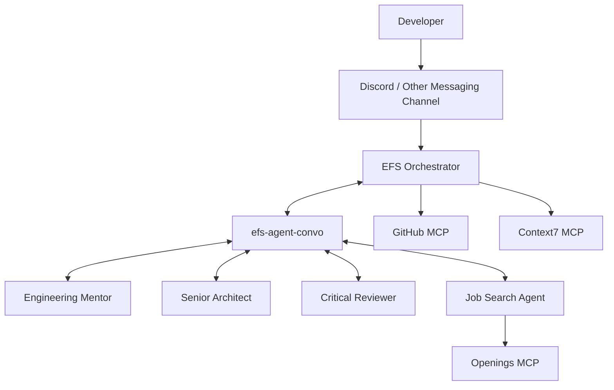

# EFS — Engineering Foundational Suite

### Your AI-powered engineering growth companion

EFS (Engineering Foundational Suite) is a coordinated multi-agent system designed to help developers learn, build, contribute to real-world software projects, and explore career opportunities.

Rather than relying on one general-purpose AI assistant, EFS brings together specialised agents with distinct responsibilities, coordinated through a central Orchestrator.

> **EFS doesn't just help you write better code. It helps you become a better engineer.**

---

## The Problem

Software engineers often rely on disconnected tools and resources throughout their development journey.

- **Learning:** Understanding unfamiliar technologies requires searching through scattered documentation and tutorials.
- **Building:** Making architectural decisions and evaluating technical trade-offs can be difficult without experienced guidance.
- **Code quality:** Developers need independent reviews that challenge assumptions and identify potential problems.
- **Open-source contributions:** Finding suitable issues and understanding unfamiliar repositories can be overwhelming.
- **Career growth:** Discovering relevant opportunities and identifying skill gaps requires continuous research.

These activities are connected, but developers often approach them independently.

## The Solution

EFS brings these capabilities together through a coordinated multi-agent system.

A central **EFS Orchestrator** acts as the developer's primary point of contact. It understands incoming requests, determines which specialists are relevant, coordinates their work, and synthesises their responses.

### What EFS provides

| Capability | What it helps with |
|---|---|
| Engineering mentorship | Understand concepts and implement solutions incrementally |
| Architecture guidance | Evaluate designs, system boundaries, and technical trade-offs |
| Critical reviews | Challenge assumptions and identify risks |
| GitHub assistance | Explore repositories, issues, and pull requests |
| Job discovery | Find opportunities and assess skill requirements |
| Documentation assistance | Retrieve relevant technical documentation |

---

## Architecture

EFS uses [Switch](https://github.com/sandbox-quantum/switch) as its agent collaboration and communication layer.

The Orchestrator coordinates specialist agents through a dedicated internal collaboration room. MCP integrations provide access to external tools and information.

### Agents

| Agent | Responsibility |
|---|---|
| `efs-orchestrator` | Primary interface and central coordinator |
| `engineering-mentor` | Technical mentorship and implementation guidance |
| `senior-architect-test` | Architecture, system design, and trade-off analysis |
| `critical-reviewer` | Independent review and identification of weaknesses |
| `job-search` | Job discovery and career-related guidance |

The internal collaboration room is named `efs-agent-convo`.

For more details, see [Architecture](docs/architecture.md) and [Agent and Skill Model](docs/agent-and-skill-model.md).

---

## Getting Started

### Prerequisites

- [Switch Console](https://docs.switchagents.ai/)
- A configured Switch server
- A supported agent provider (the reference EFS setup uses Codex)
- Git and GitHub access
- Docker, if required by your MCP deployment
- Discord or another supported messaging platform

### 1. Set up Switch

Install and configure Switch by following its [official documentation](https://docs.switchagents.ai/).

Repository: https://github.com/sandbox-quantum/switch

Switch provides the infrastructure for registering agents, configuring their execution environments, organising rooms, and connecting messaging platforms.

### 2. Configure the EFS agents

Create the five agents listed above in Switch.

For each agent:

1. Configure its name and description.
2. Select the appropriate provider and execution environment.
3. Add its corresponding agent instructions.
4. Configure the required MCP integrations.
5. Assign it to the appropriate room.

The agent instructions define responsibilities, boundaries, expected behaviour, and collaboration rules.

Refer to [AGENTS.md](AGENTS.md) for the project-level agent guidance.

### 3. Configure the rooms

EFS uses two types of rooms:

- **Developer-facing room:** The developer communicates with the EFS Orchestrator here.
- **Internal collaboration room:** Create `efs-agent-convo` and add the Orchestrator and relevant specialist agents.

The Orchestrator uses the internal room for specialist handoffs and coordination.

### 4. Configure MCP integrations

EFS uses three external MCP integrations.

| Integration | Configured for | Purpose | Credentials |
|---|---|---|---|
| GitHub MCP | EFS Orchestrator | GitHub repository, issue, and PR workflows | `GITHUB_PERSONAL_ACCESS_TOKEN` environment variable |
| Context7 MCP | EFS Orchestrator | Technical documentation retrieval | `CONTEXT7_API_KEY` environment variable |
| Openings MCP | Job Search Agent | Job discovery | Not required in the EFS setup |

**GitHub MCP**

Repository: https://github.com/github/github-mcp-server

GitHub MCP is referenced in the Orchestrator's `.toml` configuration. The configuration does not contain a token; it reads the bearer token from the `GITHUB_PERSONAL_ACCESS_TOKEN` environment variable via `bearer_token_env_var`. Set that variable in the agent session environment. Never commit tokens or secrets.

**Context7 MCP**

Documentation: https://context7.com/docs/installation

MCP endpoint:

`https://mcp.context7.com/mcp`

Context7 is configured in the Orchestrator's MCP configuration. It reads its bearer token from the `CONTEXT7_API_KEY` environment variable via `bearer_token_env_var`; no key is stored in the repository.

**Openings MCP**

Repository: https://github.com/amikai/openings-mcp

Openings MCP is configured in the Job Search Agent's `.toml` configuration. It does not require credentials in the EFS setup.

Ensure the server is reachable from the Job Search Agent's execution environment.

See [MCP Integrations](docs/architecture.md#5-mcp-integrations) for the integration responsibilities.

### 5. Connect Discord

Discord is the reference communication platform for the EFS demonstration.

Follow the official Switch guide:

**[Connect Discord — Switch Documentation](https://docs.switchagents.ai/switch-rooms/deploy/messaging-apps/discord)**

After connecting Discord:

1. Make the intended Discord channel available as a Switch room.
2. Add the EFS Orchestrator to the developer-facing room.
3. Verify the channel-to-room mapping.
4. Send a test message and confirm the Orchestrator responds.

Other supported messaging platforms can be configured using the [Switch documentation](https://docs.switchagents.ai/).

### 6. Start using EFS

Once the agents, rooms, MCP integrations, and messaging platform are configured, start a conversation with the Orchestrator.

Example prompts:

**Engineering mentorship**

> Explain how dependency injection works in Spring Boot and help me implement it in a small example.

**Architecture guidance**

> Review this proposed architecture and identify potential scalability and maintainability concerns.

**Critical review**

> Challenge this implementation approach. Identify assumptions, edge cases, and possible failure points.

**GitHub assistance**

> Help me explore this repository and identify issues suitable for a beginner-friendly contribution.

**Job discovery**

> Find backend engineering opportunities that match my current skills and identify the technologies I should improve.

The Orchestrator determines which specialists and tools are relevant, coordinates the work, and presents a consolidated response.

---

## Example Workflows

### Engineering mentorship

1. Developer asks a technical question.
2. Orchestrator identifies the learning requirement.
3. Engineering Mentor provides an explanation and practical guidance.
4. Orchestrator presents the response.

### Architecture and critical review

1. Developer shares a design or implementation approach.
2. Orchestrator delegates architecture analysis to the Senior Architect.
3. Critical Reviewer independently evaluates the proposal.
4. Orchestrator consolidates findings, trade-offs, and recommendations.

### Open-source contribution discovery

1. Developer asks for help finding a suitable contribution.
2. Orchestrator uses GitHub MCP to inspect relevant repository information.
3. Specialists assist with technical understanding and review where appropriate.
4. Orchestrator presents grounded findings and possible next steps.

### Career discovery

1. Developer describes their skills and career interests.
2. Orchestrator delegates the request to the Job Search Agent.
3. Job Search Agent uses Openings MCP to discover relevant opportunities.
4. The response highlights matching opportunities and relevant skill gaps.

---

## Project Documentation

| Document | Purpose |
|---|---|
| [AGENTS.md](AGENTS.md) | Project-level instructions and agent behaviour guidelines |
| [Architecture](docs/architecture.md) | System components, communication, and integrations |
| [Agent and Skill Model](docs/agent-and-skill-model.md) | Specialist responsibilities and reusable capabilities |
| [Development Workflow](docs/development-workflow.md) | Contribution, testing, and documentation practices |

## Scope and Limitations

EFS is an agent-coordination and engineering-assistance system. Its capabilities depend on configured agents, tools, providers, and external integrations.

- EFS does not currently depend on a custom backend or database for mission tracking.
- It does not claim persistent learner progression, scoring, or evaluation history.
- Job discovery depends on external job-source availability and behaviour.
- GitHub operations are subject to the permissions granted to the connected account.
- Agents should not claim to have inspected repositories, issues, or pull requests unless they have actually retrieved the relevant information.

## Project Vision

EFS aims to make high-quality engineering guidance more accessible by combining specialised AI agents into one coordinated experience.

From understanding a new technology to evaluating architecture, contributing to open source, and discovering career opportunities, EFS brings different parts of an engineer's growth journey into one place.

**From building software to building your career.**
