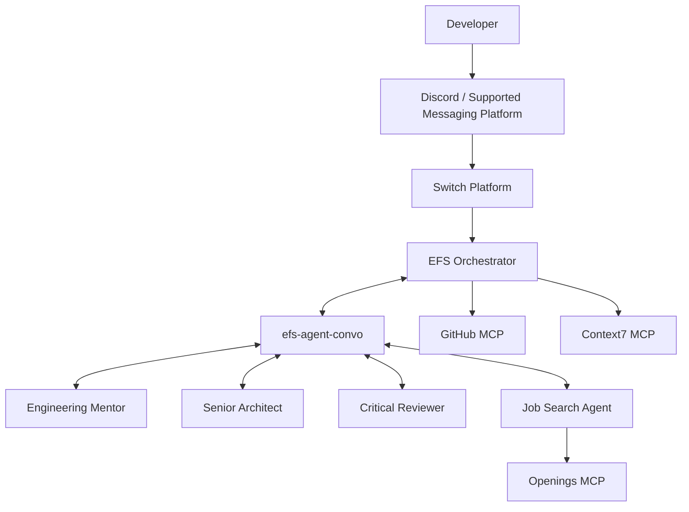
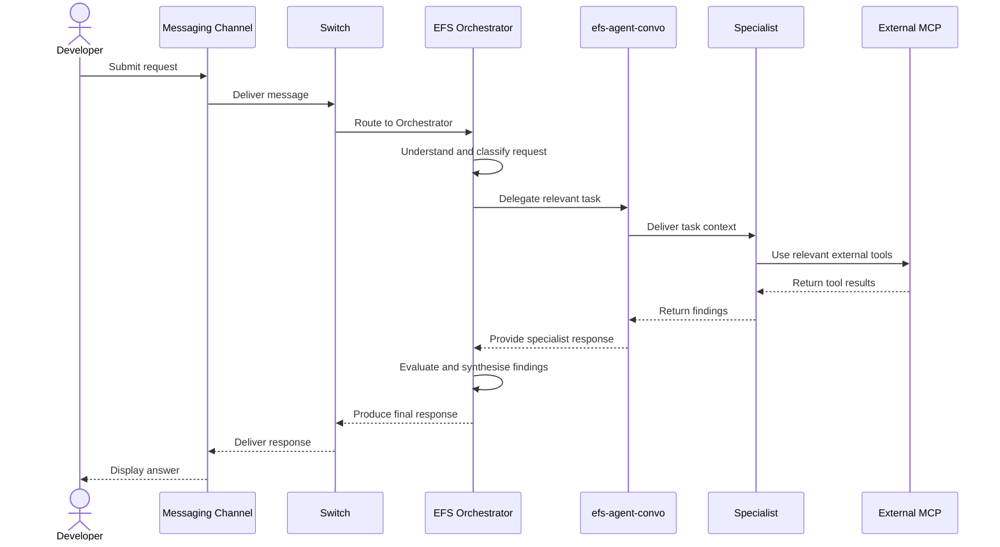

# EFS Architecture

## 1. Overview

EFS (Engineering Foundational Suite) is a coordinated multi-agent system that provides engineering mentorship, architecture guidance, critical reviews, GitHub assistance, and career discovery.

The system is built on top of [Switch](https://github.com/sandbox-quantum/switch), which provides the agent execution, collaboration, room, and messaging infrastructure.

EFS does not introduce a separate custom orchestration backend. Its coordination model uses the configured agents and Switch collaboration rooms.

## 2. Architectural Goals

The architecture is designed around the following goals:

- **Specialisation:** Give each agent a clear responsibility.
- **Coordination:** Provide one developer-facing entry point.
- **Modularity:** Allow individual agents and MCP integrations to be configured independently.
- **Tool access:** Connect agents to relevant external information and services.
- **Extensibility:** Allow additional agents and integrations to be introduced without redesigning the entire system.

## 3. High-Level Architecture

## 4. Architectural Components

### 4.1 Switch Platform

Switch provides the underlying infrastructure for:

- Registering and configuring agents.
- Selecting agent providers and execution environments.
- Managing rooms and agent memberships.
- Connecting supported messaging platforms.
- Enabling communication between agents.

Switch is the platform layer. EFS provides the domain-specific agent roles, instructions, collaboration rules, and MCP configuration.

Documentation: https://docs.switchagents.ai/

Repository: https://github.com/sandbox-quantum/switch

### 4.2 EFS Orchestrator

The Orchestrator is the primary interface between the developer and the specialist agents.

Its responsibilities include:

- Understanding incoming requests.
- Identifying the appropriate specialist agents.
- Deciding when delegation is necessary.
- Coordinating internal handoffs.
- Gathering specialist responses.
- Synthesising findings into a developer-facing answer.

The Orchestrator should not automatically delegate every request to every specialist. Delegation should depend on the task.

### 4.3 Specialist Agents

Specialist agents provide focused expertise.

| Agent | Primary domain |
|---|---|
| `engineering-mentor` | Technical learning and implementation guidance |
| `senior-architect-test` | Architecture and system design |
| `critical-reviewer` | Independent review and risk identification |
| `job-search` | Career discovery and job opportunities |

Each specialist has its own instructions and relevant tool configuration.

### 4.4 Internal Collaboration Room

The internal collaboration room is:

`efs-agent-convo`

It is used by the Orchestrator and relevant specialists to coordinate work.

A typical handoff follows this conceptual sequence:

1. Orchestrator receives a developer request.
2. Orchestrator identifies the specialist required.
3. Orchestrator sends the relevant task context through the internal room.
4. Specialist analyses the request and returns findings.
5. Orchestrator collects the response.
6. Orchestrator synthesises the final answer.

The room is a communication mechanism, not a persistent mission-tracking database.

### 4.5 Developer-Facing Communication

The developer communicates with the Orchestrator through a messaging integration.

Discord is the reference communication platform for the current EFS demonstration.

Other supported Switch messaging integrations can be used depending on deployment configuration.

Official Discord integration guide:

https://docs.switchagents.ai/switch-rooms/deploy/messaging-apps/discord

## 5. MCP Integrations

MCP (Model Context Protocol) integrations provide agents with access to external tools and information.

EFS uses three primary integrations.

### 5.1 GitHub MCP

**Assigned to:** `efs-orchestrator`

Repository:

https://github.com/github/github-mcp-server

Purpose:

- Repository exploration.
- Issue discovery and inspection.
- Pull request inspection.
- Access to supported GitHub operations.

The Orchestrator's configuration reads the token from the `GITHUB_PERSONAL_ACCESS_TOKEN` environment variable via `bearer_token_env_var`; no token is stored in the repository.

GitHub access is constrained by the permissions granted to the connected account.

### 5.2 Context7 MCP

**Assigned to:** `efs-orchestrator`

Documentation:

https://context7.com/docs/installation

MCP endpoint:

`https://mcp.context7.com/mcp`

Purpose:

- Retrieve relevant technical documentation.
- Help answer questions about libraries and frameworks.
- Reduce reliance on potentially outdated model knowledge.

The Orchestrator's configuration reads the key from the `CONTEXT7_API_KEY` environment variable via `bearer_token_env_var`; no key is stored in the repository.

### 5.3 Openings MCP

**Assigned to:** `job-search`

Repository:

https://github.com/amikai/openings-mcp

Purpose:

- Discover job opportunities from supported job boards.
- Search supported company career platforms.
- Provide job-related information to the Job Search Agent.

Openings MCP does not require credentials in the current EFS setup.

The service must be reachable from the Job Search Agent's execution environment.

### 5.4 Integration Matrix

| Integration | Agent | Authentication |
|---|---|---|
| GitHub MCP | Orchestrator | `GITHUB_PERSONAL_ACCESS_TOKEN` environment variable |
| Context7 MCP | Orchestrator | `CONTEXT7_API_KEY` environment variable |
| Openings MCP | Job Search | Not required in the current setup |

The actual server definitions belong in the relevant agent `.toml` configuration files.

## 6. Request Lifecycle

A typical request travels through the following stages:

This illustrates the intended coordination flow. The exact execution and message routing depend on the configured Switch agents, rooms, provider, and integrations.

## 7. Configuration Boundaries

EFS configuration is distributed across several layers.

| Layer | Responsibility |
|---|---|
| Switch | Agent registration, providers, rooms, and messaging integrations |
| Agent instructions | Role, behaviour, responsibilities, and delegation rules |
| Agent `.toml` files | Agent-specific MCP server configuration |
| Session environment | Credentials and runtime environment values |
| MCP servers | External tool capabilities |

Avoid treating these layers as interchangeable.

For example, adding a GitHub MCP entry to an agent's configuration does not automatically guarantee that the corresponding credentials or runtime connectivity are available.

## 8. Security Considerations

- Never commit credentials or access tokens.
- Use session-level credential injection where required.
- Apply least-privilege access to external integrations.
- Avoid exposing sensitive repository or career information in public rooms.
- Do not perform destructive GitHub operations without appropriate authorisation.
- Verify the origin and reliability of externally retrieved information.

## 9. Current Architectural Scope

The current EFS implementation is an agent-coordination system.

It does not currently introduce:

- A custom EFS API backend.
- A dedicated PostgreSQL persistence layer.
- Mission-state or learner-progression storage.
- Persistent scoring or evaluation history.

These should be treated as possible future architectural extensions, not existing components.
